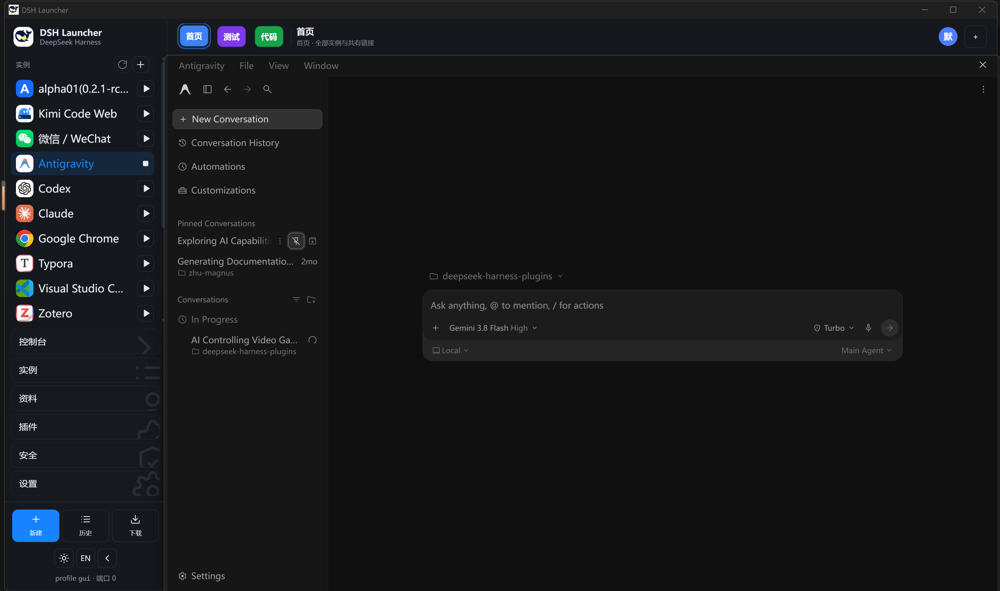
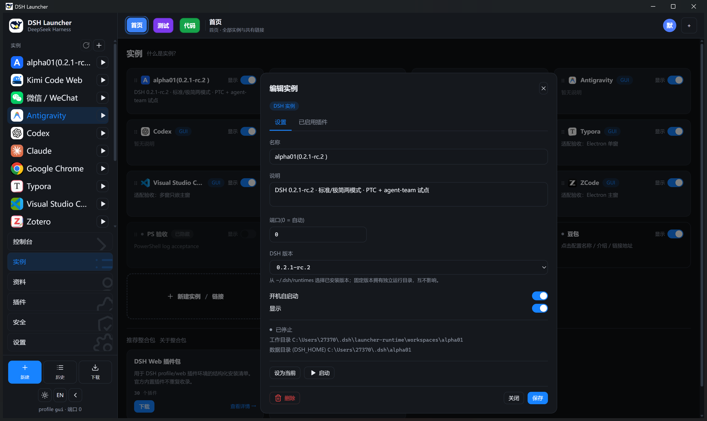
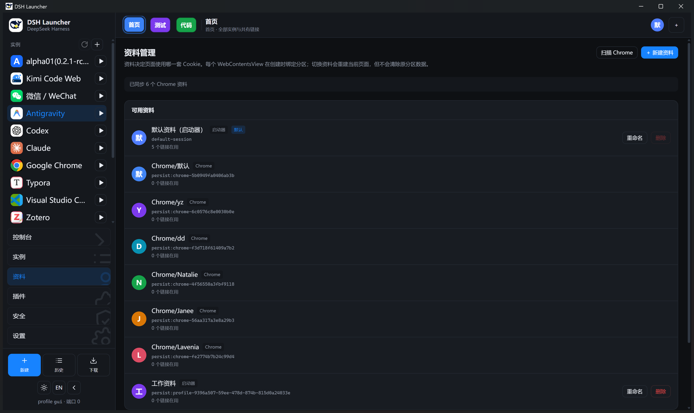
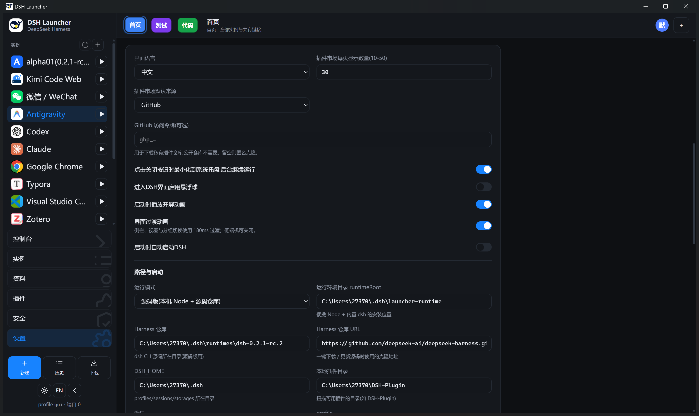
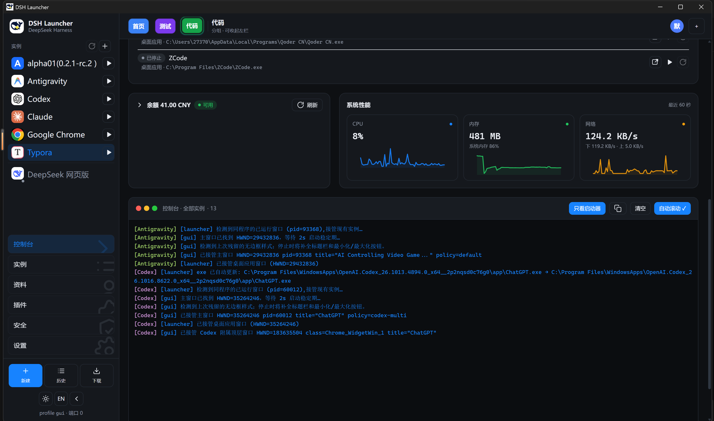

# DSH Launcher

**Windows 桌面端的 DeepSeek Harness 管理中枢：把 DSH 实例、GUI / Web 应用、登录资料、分组和 Cookie 桥收进一个窗口。**

Windows 10/11 x64 · MIT · [下载安装](https://github.com/ZhangYuanzheng1006/dsh-launcher/releases/latest) · [安装指南](docs/installation.md) · [实例说明](docs/instances.md) · [更新日志](CHANGELOG.md)



| DSH 版本隔离 | Web 登录资料 |
| --- | --- |
|  |  |

界面过渡动画可在设置中整体关闭：




## 下载

| 版本 | 文件 | 大小 |
|---|---|---|
| 安装版（推荐） | [DSH-Launcher-Setup-0.0.2-x64.exe](https://github.com/ZhangYuanzheng1006/dsh-launcher/releases/download/v0.0.2/DSH-Launcher-Setup-0.0.2-x64.exe) | 101 MB |
| 便携版 | [DSH-Launcher-Portable-0.0.2-x64.exe](https://github.com/ZhangYuanzheng1006/dsh-launcher/releases/download/v0.0.2/DSH-Launcher-Portable-0.0.2-x64.exe) | 83 MB |
| Chrome Cookie 桥扩展 | [DSH-Cookie-Bridge-0.0.2.zip](https://github.com/ZhangYuanzheng1006/dsh-launcher/releases/download/v0.0.2/DSH-Cookie-Bridge-0.0.2.zip) | 15 KB |
| 校验和 | [SHA256SUMS.txt](https://github.com/ZhangYuanzheng1006/dsh-launcher/releases/download/v0.0.2/SHA256SUMS.txt) | 295 B |

> 国内加速：给上面的链接前加 https://ghproxy.net/ 即可。
> 安装包暂未做数字签名，SmartScreen 提示时选「更多信息 → 仍要运行」。
## 主要功能

- **任意 GUI / Web / DSH 都能作为实例托管**：统一启动、停止、重启、日志和侧栏入口；桌面应用、网页服务和 DSH 实例不再散落在多个窗口里。
- **DSH 实例版本隔离**：每个 DSH 实例可绑定 `~/.dsh/runtimes/dsh-*` 中的精确版本，使用独立运行目录和独立数据目录；多版本并存，互不干扰。
- **Web 链接 Cookie 隔离**：每条网页链接可单独选择「默认资料」或隔离资料，登录态按链接隔离，不串号。
- **顶栏分组 + 按组可见性**：用分组快速切换工作区，只改变当前看到的实例和链接，不复制进程，也不清理数据。
- **全局数字快捷键**：Copilot / 应用键作为引导键，配合 `Alt + 数字` 快速切换实例和链接，侧栏同步显示编号。
- **Chrome Cookie 桥**：配套 MV3 扩展通过本机 WebSocket 单向同步 Cookie；默认免 Token，固定写入默认资料，适合 Google / Gemini 登录后复用登录态。
- **性能与效率工具**：性能面板、余额折叠条、下载与历史、链接 favicon、可关闭的界面过渡动画，让长时间使用更稳定。

## 为什么选它

和「自己开一堆窗口 / 浏览器标签」相比，DSH Launcher 把进程状态、实例切换、登录资料和常用链接集中到一个可观察的控制台：统一管理、状态可见、一键启停，资料隔离彻底。

和通用启动器相比，它不只启动命令行：原生 GUI 应用、WebUI 和 DSH 实例都能嵌入托管，并共享侧栏、分组、快捷键和生命周期管理。

## 安装与升级

1. 打开 [Releases](https://github.com/ZhangYuanzheng1006/dsh-launcher/releases/latest)，下载 Windows 安装包。
2. 双击安装并启动；首次使用在「设置 → 运行环境」完成运行环境部署，需联网。
3. 在「实例」中启动默认 DSH，或新建 GUI / Web / DSH 实例。
4. 升级时退出启动器（包括托盘），运行新版安装包覆盖安装；配置、会话、资料和独立运行版本都保存在程序目录之外。

安装包暂未代码签名，Windows 可能提示「未知发布者」。下载后请核对同一 Release 的 `SHA256SUMS.txt`。

## 数据与安全

- 默认资料直接使用 Electron `defaultSession`，不会自动搬迁或清空历史 Cookie。
- 隔离资料使用 Electron persistent partition；资料按网页链接选择，不按分组继承。
- Cookie 桥只监听 `127.0.0.1`，校验 Chrome 扩展 Origin；默认免 Token，可按需切换固定 Token。
- 扩展只同步 Cookie，不同步 localStorage / IndexedDB；不会直接读写 Chrome 的 Cookies 数据库。
- 启动器配置、备份和截图可能含敏感内容，提交 Issue 前请移除 API Key、Token、账号和 Cookie。
- Electron、Chromium 及第三方依赖保留各自许可证；应用和浏览器名称/图标仅用于识别第三方产品。

## 文档

| 内容 | 入口 |
| --- | --- |
| 安装、覆盖升级、备份和卸载 | [installation.md](docs/installation.md) |
| 实例类型、版本隔离和插件 | [instances.md](docs/instances.md) |
| Chrome 扩展安装与权限 | [Cookie Bridge](chrome-extension/README.md) |
| 源码开发、打包和验证 | [development.md](docs/development.md) |
| 版本记录 | [CHANGELOG.md](CHANGELOG.md) |

## 开发

要求 Windows 10/11 x64、Node.js 22.19+、pnpm。

```bash
pnpm install --frozen-lockfile
pnpm dev          # 开发模式
pnpm test         # 单元测试
pnpm typecheck    # 类型检查
pnpm build        # 构建 main / preload / renderer
pnpm dist         # 生成 Windows 安装包
```

## License

本项目基于 [MarcoG-h/DSH-Launcher](https://github.com/MarcoG-h/DSH-Launcher) v3.1.4 演进，保留上游 MIT 许可、版权与来源说明：

- 上游：MarcoG-h/DSH-Launcher v3.1.4
- 上游许可：MIT，见 [licenses/MIT-upstream.txt](licenses/MIT-upstream.txt)
- 本分支新增与修改部分：MIT License，完整文本见 [LICENSE](LICENSE) 与 [NOTICE](NOTICE)

感谢 MarcoG-h 发起项目，以及 baihejiangnan 对整合包和生态的贡献。本仓库是在上游 v3.1.4 基础上的独立增强分支，不代表上游官方发行。
## 更多截图



